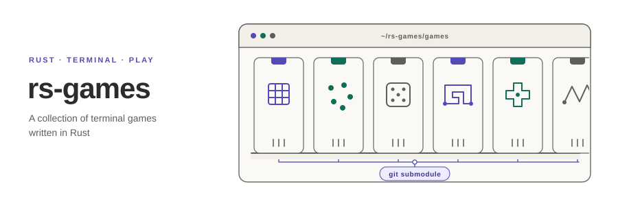

<p align="center"></p>

[English](README.md) | **日本語**

# rs-games

Rust で書いたターミナルゲームのコレクションです．各ゲームは独立したリポジトリで開発し，このリポジトリの `games/` に Git サブモジュールとして収録しています．そのため，どのゲームも単独で clone・ビルド・公開できます．

## ゲーム一覧

<!-- BEGIN:games (auto-generated by scripts/gen_catalog.py — edit games.toml then re-run) -->

2 本のゲームを収録しています．

| ゲーム | 概要 | タグ | リポジトリ |
|---|---|---|---|
| [ニム](games/rs-nim) | CPU と対戦する Nim（通常・ミゼール）．ニム和で必勝法を学べ，棋譜のリプレイ・録画にも対応． | `strategy` `ratatui` `tui` | [rs-nim](https://github.com/akitenkrad/rs-nim) |
| [三目並べ](games/rs-tic-tac-toe) | ゲーム木を読み切る CPU と対戦する三目並べ．各マスの勝ち・引分・負けを表示でき，棋譜のリプレイ・録画にも対応． | `strategy` `minimax` `ratatui` `tui` | [rs-tic-tac-toe](https://github.com/akitenkrad/rs-tic-tac-toe) |

<!-- END:games -->

## はじめに

```sh
git clone --recursive https://github.com/akitenkrad/rs-games
cd rs-games
cargo run --release --manifest-path games/rs-nim/Cargo.toml
```

`--recursive` を付けずに clone した場合は，次のコマンドでゲームを取得します．

```sh
git submodule update --init --recursive
```

1 つのゲームだけをインストールするなら `cargo install --git https://github.com/akitenkrad/<game>` を使います．

## ドキュメント

- [リポジトリの使い方](docs/usage.ja.md) — clone，更新，ゲームの実行
- [ゲームの追加](docs/adding-a-game.ja.md) — 命名，`games.toml`，一覧の生成

## ライセンス

[MIT](LICENSE)．各ゲームのライセンスは，それぞれのリポジトリに記載しています．
