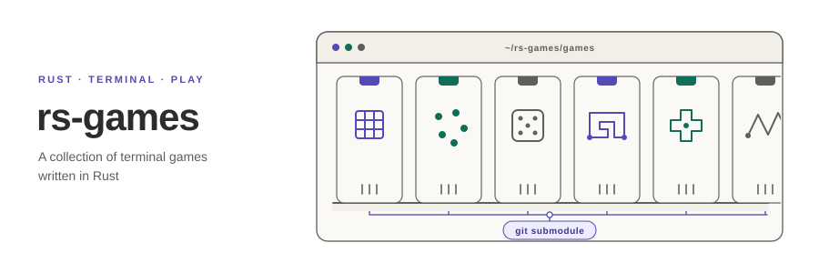

<p align="center"></p>

**English** | [日本語](README.ja.md)

# rs-games

A collection of terminal games written in Rust. Each game lives in its own repository and is wired in here as a Git submodule under `games/`, so every game can also be cloned, built and released on its own.

## Games

<!-- BEGIN:games (auto-generated by scripts/gen_catalog.py — edit games.toml then re-run) -->

2 game(s).

| Game | Summary | Tags | Repo |
|---|---|---|---|
| [Nim](games/rs-nim) | Play Nim against a CPU (normal / misère), learn the nim-sum, and replay recorded games. | `strategy` `ratatui` `tui` | [rs-nim](https://github.com/akitenkrad/rs-nim) |
| [Tic-tac-toe](games/rs-tic-tac-toe) | Play tic-tac-toe against a CPU that reads the whole game tree, see every move evaluated as win / draw / loss, and replay recorded games. | `strategy` `minimax` `ratatui` `tui` | [rs-tic-tac-toe](https://github.com/akitenkrad/rs-tic-tac-toe) |

<!-- END:games -->

## Getting started

```sh
git clone --recursive https://github.com/akitenkrad/rs-games
cd rs-games
cargo run --release --manifest-path games/rs-nim/Cargo.toml
```

If you cloned without `--recursive`, fetch the games with:

```sh
git submodule update --init --recursive
```

To install a single game, use `cargo install --git https://github.com/akitenkrad/<game>`.

## Documentation

- [Working with this repository](docs/usage.md) — cloning, updating and running the games
- [Adding a game](docs/adding-a-game.md) — naming, `games.toml` and the catalog generator

## License

[MIT](LICENSE). Each game carries its own license in its repository.
